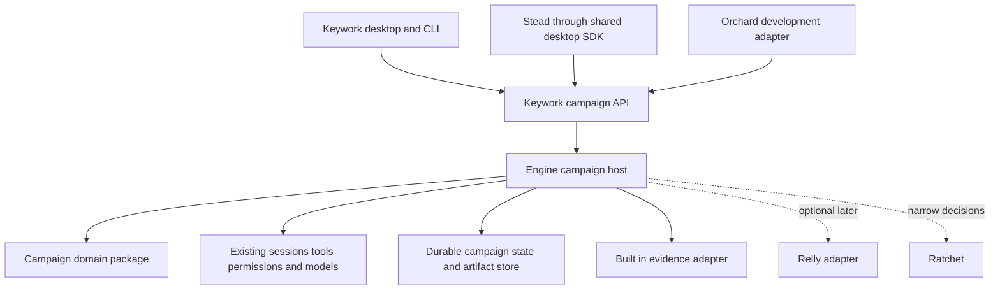

# Refinement Campaigns Architecture and Implementation Plan

Planning baseline: November 8, 2026. Implementation update: November 10, 2026. Status: integrated local implementation, with release qualification and downstream adoption pending. Product owner: Jordan. The implementation is uncommitted on `codex/refinement-campaigns` in the canonical Keywork and Keywork-app repositories.

Canonical home: Keywork `docs/backlog/123-refinement-campaigns.md`. The Keywork documentation index, backlog index, and open ledger point here; Keywork-app's documentation index links to this shared plan. The chat output is a handoff snapshot. Keep progress and decision links in this canonical copy.

Build a general refinement capability in Keywork's shared runtime, with a dedicated workspace in the desktop SDK consumed by Keywork-app and Stead. A campaign pursues a purpose through versioned artifacts, evidence, and deliberate decisions about what to do next. It supports improving an existing app, developing a new project, and refining research or plans from the first prototype.

The quality standard governs the work. Spending controls reduce waste while preserving strong creation, meaningful evaluation, and human judgment. Each model call receives an intentionally assembled working set; full artifacts and history remain durable outside the prompt.

**Live monitoring of the loop, costs, and achievements is required in the first release.** It is part of the shared campaign workspace and headless interface, backed by durable runtime events. The user can see what is happening, what it has cost, what has improved, and why the system intends to continue or stop.

**Relly is an optional future integration.** The first release must install, build, run, evaluate, and deliver all three workload classes without Relly, its publication, or a sibling checkout. This replaces the earlier proposal to make Relly packaging an initial integration priority.

# Implementation state on November 10

The runtime, wire contract, headless CLI, and shared desktop lane are connected. Existing-app,
new-project, and research fixtures execute through the same real campaign host, SQLite store,
artifact adapters, agent stages, and bounded provider wrapper using deterministic model responses.
No paid inference, publication, commits, or downstream dependency adoption has occurred.

| Area | Implemented and locally exercised | Remaining qualification |
| --- | --- | --- |
| CAM-01 and CAM-02 | Pure `@keywork/campaigns` contracts, controller transitions, fixtures, and native SQLite execution decision. | See [orchestration ADR](../decisions/001-campaign-orchestration.md); no external graph runtime dependency. |
| CAM-03 through CAM-05 | Durable events and projections, leases, stale revision refusal, operation intents, reservations, response identities, reported/estimated/unknown charges, explicit reconciliation, immutable snapshots and new-directory export. | Real paid-provider interruption and bill reconciliation pilot. Provider-side overcharges are recorded and stop execution; the local bound is not a guarantee against provider misconduct. |
| CAM-06 and CAM-07 | Selected skill instructions and resources are pinned, stage context is compiled, retired obligations remain, and optional material stays retrievable. A catalog of 500 irrelevant skills leaves a request unchanged. | Larger real workloads should calibrate working context and tool limits. Inventory fingerprints describe discovery metadata; active lock digests include selected resource contents. |
| CAM-08 and CAM-09 | Independent review stages, exact artifact/source excerpts, provisional adoption, explicit human review, regression evidence, diverse persistence perspectives, and structured handoffs. Fifth/tenth empty-attempt scenarios discover useful sixth/eleventh results within their allowance. | Empirical comparison against immediate stopping and fixed repetition. Model critique alone remains partial verification and observed achievement; it cannot certify tests, rendering, or other unperformed checks. |
| CAM-10 and CAM-11 | `keywork campaign list/create/show/watch/command/export`; existing workspace runtime and bearer auth; additive HTTP contract 1.30; reconnectable campaign SSE. | Paid outcome/cost pilot and packaged runtime exercise. Creating or monitoring a campaign does not dispatch inference. |
| CAM-12 | Shared campaign pane, live costs and trend, pending receipts, achievements/evidence, artifact text comparison/export, persistence allowance, model/cartridge controls, explicit allowance renewal, steering and human feedback. Desktop and narrow-screen component captures inspected. | Full packaged-app usability and accessibility review. Initial artifact inspection is inert text and metadata; sandboxed rendered application previews are still a separate adapter. |
| CAM-13 | Campaign pane registered in the shared SDK used by both shells. | Stead work item `wi-n89w` is a concrete draft pending human acceptance; published SDK/runtime adoption and native creature/desk/output attention integration remain unqualified. No sibling source dependency was added. |
| CAM-14 | Generic runtime/CLI seam and concrete Orchard work item `wi-zt77` prepared. | Human acceptance and implementation of the Orchard adapter. No claim, accepted criterion, merge gate, or work-item status was bypassed. |
| CAM-15 | Focused domain, execution, accounting, transport, recovery, HTTP, CLI and UI checks; public quote-only checks for selected GPT models; visual component checks. | Paid quality comparison, real-user acceptance, release/install/upgrade/rollback, CI and downstream qualification. |

The primary source paths are `packages/campaigns`, `packages/engine/src/campaigns`,
`packages/server/src/routes/campaigns.ts`, `packages/cli/src/serve-campaigns.ts`, and
`packages/cli/src/campaign-command.ts`. Keywork-app owns protocol/client campaign modules
and `packages/ui/src/panes/campaigns`. API details are discoverable in `/doc` and its fixtures.

The controller is hosted inside the existing workspace runtime. Its SQLite and artifact stores
live under the user's Keywork state directory in `campaigns/<workspace identity>`. Restart
does not automatically replay uncertain work. Expiring leases are recovered; interrupted
requests retain reservations and any response identity until explicit reconciliation.

Read [provider admission ADR](../decisions/002-campaign-provider-admission.md) before extending
model support. Admission preserves the selected model. Current bounded OpenRouter transport
supports verified GPT-family/OpenAI routes with live quoted limits; other routing, modalities,
and billing contracts require explicit admission. Reasoning, cache writes, conditional pricing,
and sibling service tiers are accounted for or refused. Monitoring and permission prompts do
not invoke an unmetered model. Shell work uses the existing permission gate and sandbox system;
a candidate directory by itself is not a security boundary.

All persistence counters survive adoption, branching, purpose changes, restart and model changes.
Renewal changes total limits only after explicit user steering. Ordinary skills are loaded only
when selected, and their supporting resources are accessed through bounded pinned reads.
The current executor uses fresh builder/reviewer sessions, 24,000 conservative input units,
4,096 output tokens, up to 12 requests and 48 tools per stage, and a 120-second attempt bound.
These are implementation defaults awaiting workload calibration, not measures of task quality.

Future agents should start from the remaining qualification column. Preserve the existing
uncommitted work, run focused checks, and obtain the required repository work-item acceptance
before changing Orchard or Stead. Publication, dependency adoption, and activation are separate
steps; a local test or published release does not prove that a downstream installation adopted it.

# Product decisions and boundaries

| Decision | Planned behavior |
| --- | --- |
| Product home | Keywork hosts the capability; Keywork-app provides detailed interaction; Stead provides persistent work and attention. Both products access the same campaign state. |
| Universal unit | A campaign connects intent, artifacts, evidence, policy, spending, and decisions. A code repository is one possible working environment. |
| Skills | Ordinary Agent Skills remain usable. Cartridges are versioned bundles of skills and supporting resources with optional runtime metadata. |
| Best result | Preserve baseline, current best, latest attempt, and meaningful alternatives separately. A failed experiment never silently replaces the current best. |
| Progress | Investigation, simplification, rejecting a candidate, and finishing without an edit are valid outcomes. A model's finish proposal is reviewed by the controller; a bounded persistence window can explore beyond repeated no-change attempts. Every iteration has a purpose without requiring a mutation. |
| Regulation | Code enforces authority, resource limits, and state transitions. Models propose interventions and interpret evidence within those boundaries. |
| Cost and quality | Measure accepted outcomes, repair, and human review alongside total cost. Budget pressure cannot silently lower quality requirements or change models. |
| Monitoring | A live campaign view and campaign list expose loop activity, spending, evidence-backed achievements, artifacts, and controls. Monitoring works without an external observability service. |
| Relly | Optional evidence adapter after the built-in workflow is useful and the reusable package is ready. |
| Initial distribution | Internal campaign package bundled into the verified Keywork runtime. No separately installed campaign engine in Stead. |
| Later distribution | A focused standalone product may use the same runtime and desktop SDK after the campaign experience proves useful. |

The first release covers local digital artifacts: file and directory snapshots, source excerpts, code changes, web previews where an execution environment is available, and structured research or decision reports. Native office formats, media generation, remote fleets, and arbitrary business-system actions can add adapters later. Existing model, tool, and permission capabilities remain the execution boundary.

The first release does not require autonomous deployment, automatic merging, a cartridge marketplace, universal self-improving evaluators, a new global memory system, or a distributed workflow service. Authorized external delivery remains a separate action with its own receipt.

# Component ownership and dependency direction

| Repository or layer | Ownership and proposed location |
| --- | --- |
| Keywork campaign package | `packages/campaigns`, private package `@keywork/campaigns`: domain types, transitions, continuation rules, artifact and evidence contracts, cartridge lifecycle, and context plans. |
| Keywork engine | `packages/engine/src/campaigns`: adapters to agent sessions, tools, permissions, models, persistence, artifact storage, and usage accounting. |
| Keywork server and CLI | Versioned campaign commands, queries, HTTP routes, SSE events, and a headless entry point. Existing authentication and transport remain authoritative. |
| Keywork-app | Campaign client projection and Solid UI in the existing protocol, client, and UI packages. The desktop SDK exports the shared experience. |
| Stead | Campaign links from creatures, routines, the desk, and outputs; product entry and packaging consume compatible compiled SDK and runtime artifacts. |
| Orchard | A development recipe adapter maps campaigns to accepted work items, scope, claims, verification, dissent, and handoffs. |
| Ratchet | Existing decision engine for narrow judgments. New campaign judgments start in shadow until their own evidence supports promotion. |
| Future evidence adapters | Relly or other selectors implement the evidence interface; they do not become requirements for basic operation. |

`@keywork/campaigns` must not import the Keywork engine, desktop UI, Orchard CLI, or Relly. It declares narrow ports that the engine implements. The engine imports the campaign package; the server exposes engine behavior; desktop clients consume the wire contract. This prevents circular dependencies and keeps domain behavior available to future surfaces.

The new package stays inside the existing Keywork monorepo. Source sharing within that monorepo uses its workspace mechanism. Cross-repository consumers use the existing runtime API and verified desktop SDK. Future Relly consumption uses a versioned package or explicitly versioned service API; sibling source imports are outside the intended distribution contract.

# User experience and first complete workflows

The user can begin with an existing deliverable and choose Improve, or begin with an idea and choose Develop. A campaign can belong to a project or the personal home. Research work does not require a Git repository.

Creation asks for purpose, starting material, references, quality expectations, and a spending boundary. Sensible defaults keep optional configuration out of the initial flow. Cartridge suggestions explain the method they add and any unavailable capability. The user may explicitly select a method or accept recommendations.

The workspace presents the current best artifact first, with a concise account of why it is preferred. It exposes alternatives, evidence, active methods, spending, and the next useful decision. Full transcripts, request identities, and implementation diagnostics live in an inspectable details view. Review supports rendered artifacts and source inspection appropriate to the artifact type.

| Workflow | Required end to end demonstration |
| --- | --- |
| Improve an existing app | Capture the current state and a user journey; propose an improvement; create an isolated candidate; inspect actual behavior; adopt or reject it; deliver the selected change and evidence. |
| Develop a new project | Turn a brief and references into bounded alternatives; select a direction; produce a runnable prototype or agreed milestone; demonstrate its purpose; deliver setup and remaining decisions. |
| Refine research or a plan | Start from provided sources and questions; identify gaps and counterevidence; create a revised report; verify claims against source references; deliver conclusions and remaining uncertainty. |

All three use the same lifecycle. Their artifact adapters and evidence methods differ. Early research demonstrations can use supplied source collections and existing authorized tools; a new retrieval service is not a prerequisite.

Pause, compare, retain this version, try another direction, change purpose, and continue from here are first-class actions. A scope or rubric change creates a new contract revision. Prior evaluations remain attached to the revision under which they were produced.

# Live loop monitoring costs and achievements

Monitoring is a required product surface. The detailed view lives in the shared desktop workspace used by Keywork-app and Stead; the headless interface exposes the same state and event stream. A compact campaign list shows running, waiting, paused, and completed campaigns, their spending, latest achievement, and any needed attention. Opening an item leads to its detailed monitor.

| View | Required first-release behavior |
| --- | --- |
| Loop activity | Show the current stage, attempt and branch, active model and cartridge, elapsed time, current operation, and last meaningful event. Explain the next proposed move and the reason to continue, change method, pause, or finish. During persistence probes, show the consecutive non-improving count, remaining allowance, extra spend, and what perspective is being tried. Distinguish a process heartbeat from useful progress. |
| Iteration timeline | Record the hypothesis, intervention, evaluation, decision, duration, cost, and resulting artifact for each attempt. Users can inspect retained, rejected, failed, and branched attempts and see which one produced the current best. |
| Costs | Show the budget, reported or settled spend, unsettled estimates, outstanding reservations, and remaining admission capacity with clear labels. Break spending down by attempt, stage, model/provider, and tool or service. Show token and cache usage where reported, and an explained spend trend. |
| Achievements | Show intended outcomes and concrete improvements with evidence and artifact links. Distinguish proposed claims, observed results, verified results, and adoption into the current best. Show unresolved criteria and later regressions alongside achievements. |
| Quality and artifacts | Compare baseline, current best, latest candidate, and retained alternatives through supported previews or diffs. Show criterion-level changes and meaningful improvements alongside cumulative cost. Annotate purpose, rubric, or evaluator changes so unlike scores are not presented as a continuous improvement trend. |
| Controls and attention | Provide pause, resume, cancel, retain best, branch, and redirect actions through existing authority checks. Surface budget pressure, repeated unproductive attempts, unresolved outcomes, required decisions, meaningful milestones, and completion. |

An achievement is an evidence-backed outcome, such as a verified user journey, a supported research conclusion, or an accepted design improvement. Completing an iteration, generating more code, and passing additional tests do not automatically establish one. Verification and adoption are separate: a verified alternative may remain unselected. Each achievement references its purpose criterion, artifact version, supporting evidence, verifier or human decision, and current validity. Subsequent counterevidence can mark it regressed or superseded without erasing its history. Useful discoveries and rejected approaches remain visible as learning outcomes with their own evidence.

Do not invent a universal completion percentage for open-ended refinement. Display milestone and criterion status, known remaining work, and uncertainty. Estimated remaining cost or time is shown only when the remaining scope supports a defensible estimate, with its assumptions. An achievement count is a navigation aid, not an optimization objective or a substitute for human assessment of the artifact.

The cost display is a projection of the authoritative ledger. Outstanding reservations are commitments, not additional settled charges. Late usage receipts update totals and affected timeline entries without double counting. Unknown usage remains visible. Charts separate settled values from estimates and show their last update; they never imply that an unanswered provider request cost nothing.

Monitoring consumes versioned runtime events and snapshots. Persist durable transitions, decisions, achievements, and usage updates; coalesce transient streaming activity without writing a durable event for every token. Reconnect replays missing events or obtains a fresh snapshot. Duplicate or out-of-order delivery cannot duplicate achievements or costs. Show connection state, last update, and stalled or unknown execution explicitly. The dashboard must not present a disconnected view as a live run.

Rendering, aggregation, and routine status updates run locally from existing state and receipts. Opening the monitor or refreshing a chart must not trigger model calls or append monitoring history to the agent's context. Any optional narrative summary uses a bounded, attributed operation and is unnecessary for basic visibility. Inspectable details include context utilization, active cartridge versions, cache use, spill references, and evaluator configuration without crowding the primary view.

Pause prevents new dispatch after the current operation reaches a safe boundary. Cancellation requests interruption where supported and prevents further dispatch, while retaining unresolved operations and potentially incurred costs. The UI distinguishes requested pause or cancellation from confirmed quiescence. Meaningful attention events use the products' existing notification surfaces with deduplication; routine token activity produces no alerts. Control receipts and subsequent state remain visible in the timeline.

The headless pilot must support status and live watching before desktop implementation. The first integrated release must demonstrate monitoring throughout each of the three workload classes, including pause/resume, reconnection, a rejected candidate, a verified achievement, and delayed cost reconciliation. External trace tools such as Langfuse remain optional diagnostics.

# Campaign contracts and state

The schema design should begin with these records. Persist a schema version and stable identifiers. Public records carry concise reasons and evidence references; they do not require storing private model reasoning.

| Record | Required meaning |
| --- | --- |
| Campaign | Identity, owner scope, purpose revision, status, current best reference, latest attempt, alternatives, budget account, active cartridge lock, and event sequence. |
| Purpose revision | Audience, intended outcome, references, quality criteria, protected invariants, permitted scope, and definition of sufficient delivery. |
| Artifact manifest | Immutable version, kind, content digest, parent versions, storage references, access scope, producer, and inspect or export capabilities. |
| Attempt | Hypothesis, expected benefit, intervention, parent candidate, execution identity, model configuration, lifecycle, and resulting artifacts. |
| Evidence item | Observation type, exact target artifact and purpose revision, provenance, method version, result, uncertainty, and accessible supporting material. |
| Evaluation | Criterion-level observations and tradeoffs, critical failures, compared candidates, evaluator configuration, and supporting evidence. |
| Achievement | Purpose criterion, claimed outcome, exact artifact, supporting evidence, verification state, verifier or human decision, adoption relationship, and later regression or supersession history. |
| Decision | Adopt, retain, branch, investigate, ask, or finish; concise rationale; evidence references; expected state revision; actor and authority. A worker's finish proposal and the controller's accepted finish are distinct events. |
| Persistence allowance | Selected profile, campaign-wide probe count limit, money and elapsed-time limits, consumed and reserved amounts, current plateau, explored directions, and termination reason. Counters survive restart and purpose or method changes. |
| Usage receipt | Campaign, attempt, operation and provider request identities; reservation; reported or estimated usage; reconciliation state; currency, pricing snapshot, and cost source. |
| Context manifest | Purpose revision, active skill hashes, artifact and evidence references, selected tools, omissions, token estimates, and actual usage when reported. |
| Handoff | Current best, active obligations, unresolved question, options and consequences, attempted approaches, and smallest useful continuation. |

Campaign statuses are draft, ready, running, waiting, paused, completed, cancelled, and failed. Waiting records whether it needs a person, an external dependency, or reconciliation. Attempt outcomes are tracked separately. Delivery and verification are separate fields: a completed process does not by itself establish successful delivery or verified quality.

The next-move planner proposes an operation. Deterministic checks validate its authority, budget, prerequisites, and current state revision before execution. Adoption requires evaluation of the candidate against the current best and the original purpose. Critical invariants are gates; favorable subjective scores cannot offset their violation. Preserve multiple candidates when their tradeoffs require human preference.

Continuation considers unresolved value, recent accepted improvements, repeated failures, oscillation, complexity growth, uncertainty, and remaining evaluation capacity. A run of unchanged candidates is evidence about the approaches tried, not proof that useful improvements are exhausted. Initial continuation rules are explicit and inspectable. Learned judgments can later supplement them with measured calibration.

Before a further attempt, record either a specific limitation and proposed intervention, or an exploratory question and perspective that may reveal a worthwhile opportunity. State what observation could justify adoption. Exploration does not require pretending to know the improvement before discovering it. Resource ceilings, authority, and critical invariants remain independently enforced. A worker's inability to name another improvement invokes the bounded persistence policy below; after its allowance is exhausted, retain the best result or provide a structured handoff.

# Bounded persistence after premature finish proposals

A model may propose finishing several times before a later attempt discovers a useful direction. The product should have patience for that possibility while measuring its actual value. The 5-10 unsuccessful attempts motivating this policy come from the user's observation of the reference video; they are a design scenario, not a verified success rate or a universal model threshold.

Distinguish an ordinary end-of-turn, a soft finish proposal such as "nothing worthwhile remains," and a mandatory stop. The controller owns campaign completion. A soft finish proposal can open a finite exploration window from the current best artifact. An explicit user stop, denied permission, applicable safety boundary, exhausted budget, or unresolved external effect remains a real boundary. The persistence policy does not instruct models to circumvent refusals or repeat blocked actions.

Use a single persistence preference with bounded profiles. Initial pilot candidates are Focused (up to 2 additional probes), Persistent (up to 8), and Deep (up to 12), with Persistent as the starting candidate for open-ended refinement. These are provisional ceilings to evaluate, not minimum iteration counts or established optimal defaults. Deep must be able to survive ten unsuccessful probes and evaluate a discovery on the eleventh. The same mechanism supports lower or zero allowances for narrow tasks. A profile also needs an explicit money and elapsed-time allowance within the overall campaign limits; a count alone does not authorize spending.

Each probe may inspect, investigate, propose, or create an isolated candidate, and may legitimately find nothing. The controller can change the method: inspect the whole artifact from a user's perspective, challenge an assumption, compare an excellent reference, seek a counterexample, simplify a design, or invite an independent approved model or cartridge. A fresh context carries the current purpose, best artifact, obligations, and a compact record of approaches tried; it need not inherit a transcript of repeated resignation. Diversity is a way to explore, not a demand that every probe invent a new flaw. Repeated stochastic sampling of a useful perspective is also allowed as an explicit, bounded experiment.

A sequence of no-change results does not by itself terminate the selected window early. Further probes remain admissible while the authorized exploration purpose, methods, and resource limits hold. End earlier when the user stops, a mandatory boundary applies, the next probe and its evaluation cannot fit, or independent task-specific evidence establishes that continued probing would violate scope or protected quality. Mere confidence or repeated assertions that the work is finished do not establish that evidence. A redundant probe consumes allowance; provider retries and failures consume their applicable operation and resource limits and cannot create an unlimited retry path.

Keep probe execution separate from candidate adoption. Work from immutable references or isolated alternatives, preserve the current best, and apply the existing critical gates and material quality criteria before adopting anything. Neither novelty, greater complexity, cosmetic churn, nor reaching a prescribed iteration count earns adoption or an achievement. A genuine evaluated gain can resume ordinary refinement, but all campaign-wide probe, cost, and time counters remain consumed. A branch, new cartridge, rubric change, or minor gain cannot silently replenish them. Renewing an exhausted allowance requires an explicit steering decision that records the new limits within the campaign budget; the probing worker cannot grant itself an extension.

Reserve evaluation and delivery capacity before exploration. The monitor shows "exploring beyond a finish proposal," attempts spent without an accepted improvement, the remaining probe and resource allowance, and the outcome of each probe. When a useful result arrives after several empty attempts, link the achievement to the evidence and show the incremental exploration cost. When no result arrives, report the exhausted search and retain the best artifact without manufacturing progress or soliciting another extension indefinitely.

Validate the policy in two ways. Scripted controller scenarios establish correct counters and boundaries: five empty probes followed by a useful sixth; ten followed by a useful eleventh under Deep; a fully exhausted window with no gain; a novel but worse candidate; and an immediate user or budget stop. These fixtures demonstrate control behavior, not model capability. Live workload comparisons test finish-on-first-proposal, bounded persistence, and a simple fixed refinement loop under the same total spending ceiling, with evaluation and delivery reserved. Track material gains found after the first finish proposal, their extra cost and time, regressions, and human preference. Adjust the default profile from those outcomes.

# Durability and artifact handling

Use the existing local runtime and SQLite infrastructure where appropriate. One component owns authoritative campaign transitions. Store events and materialized campaign state transactionally, with monotonically increasing sequence numbers and optimistic revision checks. Sessions remain execution records referenced by a campaign; their conversation journals do not become the campaign database.

An execution lease prevents two coordinators from advancing the same campaign concurrently. Lease recovery must inspect unfinished operations before scheduling another attempt. SSE consumers deduplicate by event identity and recover from missed events using a snapshot and cursor.

Persist operation intent before dispatch. Record results and usage before marking an operation complete. Distinguish known failure from unknown outcome. A timeout after a paid call or external write must enter reconciliation rather than trigger a blind retry. Where providers do not offer idempotency, the design must tolerate uncertainty rather than claim exactly-once effects.

Artifact creation writes to staging, verifies content, and commits an immutable manifest reference before candidate adoption. Recovery detects incomplete staging and unreferenced content. Retention keeps the baseline, selected result, retained alternatives, and evidence required to understand decisions. Garbage collection follows explicit retention policy and access rules.

Code candidates use isolated worktrees or workspaces. Capture unsaved starting material deliberately and preserve user edits. Conversation forks alone do not isolate filesystem changes. File snapshots cannot reverse messages, payments, remote mutations, or other external effects; those operations require separate authorization and recovery behavior.

The initial workflow-backend decision remains open. A bounded spike compares the native state machine with LangGraph for interruption, resume, branching, cancellation, and ambiguous side effects on the supported Bun and Windows/Linux environments. Adopt LangGraph only if it simplifies the host without creating a second permission system, conflicting campaign store, or unacceptable packaging burden. Record the result in a Keywork ADR before dependent implementation. Temporal remains a later option for demonstrated distributed execution needs.

# Skill cartridges and lifecycle

Support standard `SKILL.md` instructions and resources directly. A richer bundle may add a small manifest describing identity, version, supported artifacts, entry skills, stage applicability, required capabilities, provided outputs, reference assets, and evaluation resources. The manifest is declarative; executable scripts run through existing tool and sandbox boundaries.

Separate discovery, inspection, activation, suspension, retirement, and reactivation. Inspecting a skill does not make it permanently active. Activation pins its version and records applicable stages and continuing obligations. Repeated activation of the same version does not duplicate instructions. Retiring a stage removes its procedures from subsequent working sets while preserving accepted constraints and decisions.

Compose methods explicitly. The campaign selects a primary method for a stage and adds compatible supporting skills. Detect conflicting output contracts, incompatible requirements, and duplicate responsibilities before running them. Skills can request capabilities but cannot grant themselves permission or weaken campaign policy.

Keep trust boundaries explicit. Retrieved sources, tool output, and candidate artifacts are task data; instructions embedded in them cannot activate cartridges, change policy, or grant capabilities. Activating a cartridge records its origin and existing trust decision. Exposing secrets, executing bundled code, and accessing external systems continue through the runtime's scoped tool permissions. Include adversarial source instructions in the boundary checks.

Cartridges contribute evaluation methods; the accepted campaign rubric remains independently versioned. Holdout evaluation material is available only to the appropriate evaluator. Builder-produced claims are labeled as claims until checked. A cartridge cannot modify its own acceptance boundary during an attempt.

Published bundles are immutable for a running campaign. Agent-proposed repairs create candidate versions for later evaluation. An explicit version transition records the reason and invalidates affected evidence or caches. A simple lock manifest pins bundle identity and digest; avoid a new dependency solver when normal package tooling can resolve executable dependencies.

The first bundle set demonstrates research synthesis, product exploration, implementation, artifact critique, and delivery. These can reuse existing project skills after compatibility review. A full marketplace and broad automatic skill evolution are deferred.

# Context assembly and quality preservation

Treat each request as a compilation of current campaign state. The request consists of mandatory campaign essentials, complete active instructions, working evidence, selected artifact material, and required tools. Full history remains external and retrievable. References preserve access to information without automatically placing its entire contents in the prompt.

The compiler performs these steps:

1. Resolve the purpose revision, active obligations, current best, and operation being attempted.
2. Resolve active skill versions and required tool capabilities. Preserve mandatory instructions intact.
3. Select relevant artifact changes, source excerpts, prior decisions, and unresolved evidence. Begin with direct references and deterministic filtering; optional semantic retrieval can be added behind the evidence interface.
4. Deduplicate by content identity and provenance while preserving distinctions between claims, independent sources, and contradictory observations.
5. Fit optional material to the stage's working budget while reserving response and provider overhead. If mandatory content cannot fit, split the work or choose a supported larger context deliberately; never silently clip requirements.
6. Produce a manifest of included and omitted material, with reasons and retrieval handles.
7. Execute and compare estimated context and cache behavior with provider-reported usage.
8. Persist new observations and decisions; retire completed-stage procedures before assembling the next working set.

Catalog discovery must scale independently of total installed skills. Keep the full index outside the prompt, expose a relevant shortlist, and provide search with exact selection available. Deferred tool discovery must similarly avoid advertising every schema. Existing Keywork skill tools, MCP discovery, spill storage, and context accounting provide starting points.

Active instructions survive compaction by exact pinned reference. Completed-stage instructions do not remain permanently pinned. Deactivation cannot erase previous provider-managed context automatically; start a fresh phase session or construct a valid new request where necessary, and verify actual usage. Cache discounts reduce billing but do not remove tokens from the model's context.

Use structured observations plus links to complete tool results. Avoid serializing screenshots or large binary artifacts into text. Model-specific image and tool overhead must be reflected in admission estimates. A new context window must preserve valid tool-call/result pairs and all current authority constraints.

Preserve craftsmanship by making room for excellent references, counterexamples, whole-artifact inspection, and unresolved qualifications. Context limits are working budgets, not an incentive to minimize every request. Permit deliberate expansion for holistic reasoning. Retrieval omissions remain inspectable, and the agent can request original material. Independent evaluators receive the purpose and artifacts without automatically receiving the builder's self-justification.

# Model selection and spending control

Start with OpenRouter through Keywork's existing provider layer. Pin the requested model and record the actual served model, provider, effort configuration, and available capability metadata. Keep a strong primary model for coherent creation and use independent judgment at meaningful checkpoints. Cheaper models are introduced for bounded tasks only after workload evidence supports the substitution.

One campaign account reserves funds before every paid operation, including planning, building, reviewing, compaction, retrieval, media, tools, and execution services. Child operations draw from that account. Parallel branches require independent reservations, and evaluation capacity is reserved before launching a candidate. Persistence probes use an explicitly allocated portion of this same account and preserve evaluation and delivery capacity; a patience profile never increases the overall spending ceiling.

Track estimated, reserved, reported, and reconciled amounts separately. Use unique operation and request identities to prevent double counting. Missing usage stays unresolved rather than becoming zero. Failed and cancelled attempts remain chargeable when the provider incurred cost. Record provider totals without counting reasoning tokens again when they are already included in billed output.

Persist the currency, rate snapshot and retrieval time, cache category, and any reported credits or adjustments alongside usage. Show estimated and settled spending distinctly. Approved fallback routes must satisfy the operation's capability and cost bounds; an unavailable model cannot silently become a materially different or unbounded request.

Enforce call admission using conservative bounds derived from supported token caps, pricing, tool limits, and approved provider routes. If an operation cannot be bounded, its estimate must not be presented as a hard cap; require an explicitly permitted policy for that operation or choose a bounded alternative. Provider-reported usage and later reconciliation remain authoritative for settled charges.

Cost savings should first come from valid reuse, cache-aware stable prefixes, focused context, deterministic checks, selective evaluation, and better stopping. Cache reuse keys include relevant artifact, purpose, skill, evaluator, permission, and provider configuration versions. Access is checked again before exposing cached source content.

When funds cannot support the next useful operation and its evaluation, preserve the current best and explain the continuation choice. Never silently weaken quality criteria, select a cheaper model, or omit required verification. Local compute can have an estimated resource cost; absence of an estimate is not proof that it is free.

Optional Langfuse export can help analyze costs and failures. The local ledger controls admission. Export failures cannot block or authorize work, and trace content follows explicit data-export settings.

# Evidence and evaluation without Relly

The built-in evidence adapter supports registered source snapshots, exact excerpts, file and artifact references, tool observations, manual evidence, and simple local search. It exposes inspect and retrieve operations with provenance and access checks. Existing authorized research tools may add sources. This is enough to demonstrate all three workload classes.

Evaluation combines methods appropriate to the purpose: executable checks, observed user journeys, rendered artifact inspection, source support, counterevidence, independent critique, and human preference. Code volume, test count, number of features, and a model's confidence are not success metrics.

Freeze critical criteria and comparison procedures before evaluating a candidate. Separate development feedback from held-out final evaluation. Repeatedly querying a holdout makes it part of the optimization process; record that exposure and replace the holdout when necessary. Treat agreement among similar models as correlated evidence.

The escape hatch changes the method when evidence stops being informative. It can request missing information, gather a different source, create a distinct alternative, escalate to a more capable evaluator, or propose a purpose revision. The handoff explains the unresolved decision and its consequences. Authority and budget changes remain governed by existing user grants.

# Delivery milestones and work items

The identifiers below are planning references. They are not accepted Orchard work-item IDs. Before execution, translate each item into the canonical repository's work format and record its file scope, dependencies, acceptance commands or demonstrations, and handoff expectations. Existing repository rules for dependencies, protected paths, commits, and releases continue to apply.

## Milestone zero Contracts and execution choice

**CAM-01 : Domain contracts and three workload fixtures.** Owner: Keywork. Define campaign, purpose, artifact, evidence, achievement, decision, persistence allowance, cartridge activation, context manifest, usage records, and monitoring events. Supply one coherent fixture for each workload. Acceptance: each fixture makes a full proposal-to-delivery transition through the same contracts; research requires no repository or Relly; critical failures cannot be outvoted by a subjective score; verified achievements remain distinct from model claims and candidate adoption.

**CAM-02 : Durability and orchestration spike.** Owner: Keywork. Depends on CAM-01. Compare native orchestration with LangGraph using scripted operations. Exercise pause/resume, a process restart, branching, stale decisions, cancellation, and a lost response. Acceptance: a written ADR chooses one execution owner and records runtime compatibility, dependency cost, state ownership, and unresolved risks. No live-model expense is required for this spike.

Exit: contracts and an execution decision are concrete enough to implement without duplicating engine, permission, or persistence systems.

## Milestone one Durable campaigns and bounded spending

**CAM-03 : Campaign store and event stream.** Owner: Keywork. Depends on CAM-01 and CAM-02. Implement versioned persistence, revision checks, execution leases, restart recovery, snapshots, and event cursors. Include durable loop, achievement, decision, and usage events plus a derived monitoring projection. Acceptance: a stale client cannot overwrite a newer decision; reconnect reconstructs the same campaign and timeline without duplicate achievements or spending; crash recovery does not blindly repeat an operation with an unknown outcome; transient activity is bounded and distinct from durable progress.

**CAM-04 : Artifact snapshots and candidate isolation.** Owner: Keywork. Depends on CAM-01. Implement immutable manifests, staging, baseline capture, best/latest/alternatives, file and directory adapters, and isolated code workspaces. Acceptance: rejected candidates preserve the best result; unsaved user material survives; a session fork is not mistaken for filesystem isolation; exported artifacts match their manifests.

**CAM-05 : Campaign budget account and receipts.** Owner: Keywork. Depends on CAM-01 and CAM-03. Connect all paid operations to reservations, bounded admission, actual usage, and reconciliation. Expose live spending totals and breakdowns by attempt, stage, model/provider, and paid tool or service. Acceptance: parallel operations cannot reserve the same remaining funds; duplicate receipts do not double charge; unknown costs remain visible; cancellation preserves potentially incurred charges; evaluation and compaction spend are attributed; monitoring separates reservations, estimates, and settled costs and updates affected totals on reconciliation.

Exit: a scripted campaign survives interruption, preserves its artifacts, and accounts for every operation without claiming stronger billing guarantees than its providers support.

## Milestone two Cartridges and context assembly

**CAM-06 : Cartridge discovery and lifecycle.** Owner: Keywork. Depends on CAM-01 and CAM-03. Add versioned activation, inspection, retirement, rehydration, compatibility checks, and scoped search. Acceptance: ordinary skills work; inspection alone does not activate; repeated activation does not duplicate; retirement preserves continuing obligations; unavailable capabilities produce an actionable explanation.

**CAM-07 : Context compiler.** Owner: Keywork. Depends on CAM-04 and CAM-06. Assemble stage-specific requests and context manifests using existing deferred tools and spill storage. Acceptance: mandatory instructions remain intact; a large irrelevant catalog does not inflate an unchanged request; retired skills leave later working sets; original evidence remains accessible; resume restores exact active versions; valid provider message structure is preserved.

**CAM-08 : Built-in evidence and evaluation adapters.** Owner: Keywork. Depends on CAM-01 and CAM-04. Support source registration, excerpts, observations, simple search, rubric evaluation, independent review contexts, and evidence-backed achievement records. Acceptance: claims trace to exact artifacts or sources; contradictory evidence remains representable; achievement verification and later regression trace to evidence; source access is rechecked; all demonstrations work with Relly absent.

Exit: the system can change methods without accumulating all prior instructions, and quality-critical evidence remains available under context pressure.

## Milestone three Complete headless refinement

**CAM-09 : Next-move planning candidate selection and bounded persistence.** Owner: Keywork. Depends on CAM-03 through CAM-08. Implement investigate, revise, simplify, branch, ask, adopt, retain, and finish; distinguish soft finish proposals from accepted completion; implement persistence profiles, durable resource counters, method changes, and structured handoffs. Acceptance: the system can finish without editing, reject regressions, preserve meaningful alternatives, and pause for an actual consequential decision. Scripted scenarios must find a useful sixth probe after five empty ones and a useful eleventh after ten under Deep, stop at the authorized limits, preserve the best on regression, honor mandatory stops immediately, and never replenish allowance through branching or cosmetic progress.

**CAM-10 : Headless entry and pilot across three workloads.** Owner: Keywork. Depends on CAM-09. Add the campaign CLI or headless API, including status and live watch, and run the three fixture workflows through real execution adapters. Acceptance: app improvement, new-project development, and research refinement each produce inspectable deliverables, evidence, cost receipts, and resumable state using the same campaign model; users can follow loop activity, costs, achievements, and the reason for continuation or stopping while work runs.

Exit: the capability is useful without the desktop UI, with an initial quality and cost comparison against simpler approaches.

## Milestone four Shared desktop workspace

**CAM-11 : Versioned campaign wire contract.** Owner: Keywork and Keywork-app, with server behavior owned by Keywork. Depends on CAM-03 and CAM-09. Define commands, queries, events, monitoring snapshots and projections, structured refusals, and conflict responses; update protocol fixtures. Acceptance: all state changes use server authority; snapshot and SSE projections agree on activity, spending, and achievements; clients handle stale revisions, delayed receipts, reconnect, and unsupported capabilities; requested control actions remain distinct from confirmed execution state.

**CAM-12 : Live campaign monitor workspace and artifact review.** Owner: Keywork-app. Depends on CAM-10 and CAM-11. Build the shared Solid campaign list and detailed monitor with loop activity, iteration timeline, cost totals and breakdowns, achievements, current best, comparisons, evidence, active methods, and steering. Acceptance: users can create, inspect, pause, resume, cancel, compare, retain, and redirect a campaign; every monitoring view specified in this plan works across all three workloads; persistence activity, unsuccessful probe count, remaining allowance, and incremental exploration cost are visible; charts label estimates and criterion changes; stale data is visibly marked; achievements link to evidence and artifacts; the renderer holds no model credentials or execution logic; keyboard and accessibility paths work; whole-artifact review is available for supported adapters; ordinary monitoring triggers no model calls.

**CAM-13 : Stead integration and compatible packaging.** Owner: canonical Keywork and Keywork-app for shared behavior; Stead for entry and packaging. Depends on CAM-12. Add compact activity, cost, achievement, and attention summaries with campaign links to existing creature, routine, desk, and output surfaces. Acceptance: both products open the same detailed monitor and agree on state; attention events use existing surfaces without duplicate alerts; only one execution owner advances a campaign; closing a view does not implicitly cancel authorized background work; cancellation revokes further dispatch; compatible compiled artifacts are installed and checked together.

Exit: the same campaign feels native in both products and remains recoverable independently of an open window.

## Milestone five Development recipes and release readiness

**CAM-14 : Orchard development adapter.** Owner: Orchard, with needed runtime support owned by Keywork. Depends on CAM-10 and CAM-11. Map campaigns to accepted work, touches, claims, evidence, verification, dissent, and handoffs. Acceptance: existing governance remains authoritative; the adapter produces concrete reviewable work without creating another agent engine; broader research campaigns remain usable without Orchard.

**CAM-15 : Outcome evaluation and release qualification.** Owners: each canonical repository for its changes. Depends on CAM-10 through CAM-14. Complete realistic workload comparisons, recovery scenarios, install/upgrade/rollback demonstrations, and documentation. Acceptance: critical invariants hold; user review accepts the intended workflows; live monitoring of loop activity, costs, and achievements passes the required scenarios in all three workloads; bounded persistence is compared with immediate finishing and fixed repetition using actual outcomes and extra spend; cost and quality tradeoffs are explicit; native product compatibility is demonstrated; every material limitation has an owner and a visible behavior.

Exit: the first integrated release is ready for the existing human release process. Package publication, commits, and deployment follow explicit authorization and each repository's rules.

# Evaluation and engineering acceptance

Start with one representative case per workload and scripted recovery scenarios. Compare a strong single pass, a simple builder-critic loop, and the campaign approach using the same primary model, starting materials, and declared spending ceiling. Record actual spend and elapsed time separately. Expand to held-out cases only when the small pilot demonstrates enough value to justify the cost. Choose the live-run budget before dispatch.

Evaluate actual outcomes: end-to-end usefulness, correctness, coherence, finish, source support, regressions, subsequent repair, human preference, review time, interruptions, total cost, and sensible stopping. Blind candidate identity and randomize presentation order where feasible. Small pilots establish direction; they do not prove universal superiority.

The release decision must identify whether the campaign offers better quality at an acceptable incremental cost, comparable quality at lower total cost, or a valuable reduction in human effort. Cheap tokens alone are insufficient. Cheaper-model substitutions are a separate experiment after measuring the controller's contribution.

| Engineering scenario | Required outcome |
| --- | --- |
| Grow the catalog from a small set to many irrelevant skills | The unchanged active request remains within the same declared working envelope; relevant and explicitly requested methods remain discoverable. |
| Activate, inspect, retire, compact, and resume cartridges | Exact active instructions and obligations survive; inspected or completed-stage content does not accumulate indefinitely. |
| Required content exceeds the working budget | The system expands deliberately, splits work, or requests a decision; it does not silently drop requirements. |
| Large tool output or artifact | Full content is stored and retrievable; the request carries an appropriate bounded observation and reference. |
| Crash around dispatch, artifact persistence, or adoption | Recovery preserves state and best artifacts; unknown operations reconcile before retry. |
| Concurrent desktop clients | Revision checks and leases prevent duplicate advancement or lost decisions. |
| Lost usage response or duplicate receipt | Unresolved cost remains visible and reserved; settlement is deduplicated. |
| Cartridge, rubric, source, or permission changes | Affected evidence and caches are invalidated or revalidated under explicit versions. |
| Relly, Langfuse, or a desktop client is absent | Core campaigns continue within their available capabilities. |
| Misleading critique or favorable score on a broken candidate | Critical evidence prevents adoption; the original best stays available. |
| Five or ten soft finish or no-change results precede a useful candidate | Within a sufficient authorized profile and resource allowance, the controller reaches and evaluates the sixth or eleventh probe without treating the earlier sequence as proof of exhaustion. |
| Every persistence probe is empty or produces a worse candidate | The configured window ends, spending stays bounded, and the best artifact remains intact with an honest account of the search. |
| A branch, restart, method change, or cosmetic edit occurs during persistence | Durable campaign-wide counters remain consumed; no silent reset or unlimited retry path is introduced. |
| User cancellation, denied authority, safety boundary, or budget exhaustion occurs during persistence | The applicable stop takes priority over the remaining probe count. |
| Instructions embedded in sources, tool output, or candidate artifacts | They remain task data and cannot change active skills, permissions, policy, or spending limits. |
| Monitor disconnects, reconnects, or receives duplicate and delayed events | It marks stale state, recovers the same timeline, and reconciles achievements and costs without duplication. |
| A claimed achievement is disproved or its purpose changes | Verification, adoption, regression, and supersession remain distinct and traceable; unrelated rubric scores are not charted as continuous progress. |
| Monitor is opened, refreshed, or left running | Rendering and ordinary status updates require no extra model calls and do not grow the agent context. |
| Pause or cancellation occurs during a paid operation | Requested and confirmed state are distinct; further dispatch stops at the applicable boundary; pending effects and costs remain visible. |

Use meaningful tests for state transitions, accounting, authority, persistence, and protocol behavior. Validate craft through demonstrations and artifact review. Existing repository checks remain required for implementation changes: Keywork and Keywork-app use `bun run check` and `bun run test`; Stead and Orchard use their current documented verification ladder. Determine exact commands and scopes when creating each implementation item.

# Optional integrations and later decisions

| Integration | Entry condition and boundary |
| --- | --- |
| Relly | Built-in evidence handling has a demonstrated limitation that Relly addresses. Its reusable API, compatible Ratchet dependency, package contents, runtime requirements, and clean installation are verified first. No first-release dependency or publication blocker. |
| Langfuse | Trace analysis provides value during the pilot. Export is optional, access-controlled, and independent of authoritative spending control. |
| Temporal | Distributed work, long waits, or operational recovery needs justify a service and deployment model beyond the local runtime. |
| OpenHands | A benchmark or executor adapter demonstrates useful capability relative to the existing execution engine. |
| GEPA or recipe optimization | Repeated tasks, trustworthy feedback, held-out evaluation, and a frozen policy boundary exist. Candidate recipe versions are evaluated before adoption. |
| Standalone application | The shared campaign workspace has proven independent demand. Add a focused product surface while retaining the same runtime and data contracts. |

The execution backend, local state placement, artifact interface, cartridge lock and bounded provider admission now have concrete implementations and the linked ADRs. Retention policy, rendered artifact adapters, broader provider admission, and the pilot's persistence spending and time allowances still need qualification. The provisional persistence counts require outcome calibration before release.

# Source map and implementation handoff

The existing architecture places runtime behavior in Keywork and desktop presentation in Keywork-app, with Stead consuming compiled artifacts. Relevant local sources include `C:/src/keywork/AGENTS.md`, `packages/engine/src/routines/store.ts`, `packages/engine/src/routines/scheduler.ts`, `packages/engine/src/models/ledger/`, `packages/engine/src/skills/tools.ts`, `packages/engine/src/skills/library.ts`, `packages/engine/src/session/compaction.ts`, `packages/engine/src/session/context-map.ts`, `packages/engine/src/session/spill.ts`, and `packages/engine/src/mcp/registry.ts` within Keywork. Keywork-app's `AGENTS.md`, `scripts/pack-sdk.ts`, and product profiles define the client and packaging boundary; Stead's `docs/repos.md` and Keywork's `docs/runtime-upgrades.md` define shared artifact ownership and upgrade constraints. Revalidate source and package versions when beginning implementation.

Use the [Agent Skills specification](https://agentskills.io/specification) for portable skill structure and its [integration guidance](https://agentskills.io/client-implementation/adding-skills-support) for progressive loading and activation behavior. The cartridge lifecycle in this plan adds campaign-specific versioning and retirement.

Use [OpenRouter usage accounting](https://openrouter.ai/docs/cookbook/administration/usage-accounting), [provider routing](https://openrouter.ai/docs/guides/routing/provider-selection), and [prompt caching](https://openrouter.ai/docs/guides/best-practices/prompt-caching) to implement provider-specific receipts and routing. Campaign-wide reservation and reconciliation remain application responsibilities.

The orchestration spike should follow [LangGraph persistence](https://docs.langchain.com/oss/javascript/langgraph/persistence) and [interrupt semantics](https://docs.langchain.com/oss/javascript/langgraph/interrupts), including repeated side effects on resume. Evaluation design can draw on [Anthropic's agent evaluation guidance](https://www.anthropic.com/research/demystifying-evals-for-ai-agents), while the independent [OpenHands refinement example](https://docs.openhands.dev/sdk/guides/iterative-refinement) supplies a comparison baseline.

Implementation began with CAM-01 and CAM-02 and now reaches the shared runtime and desktop lane. Continue from the implementation-state table and linked ADRs, preserving actual qualification limits. The CAM identifiers are planning references; this document does not itself accept Orchard or Stead work items or change repository governance.
